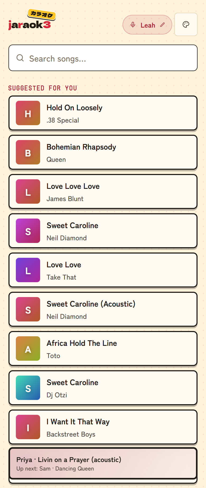
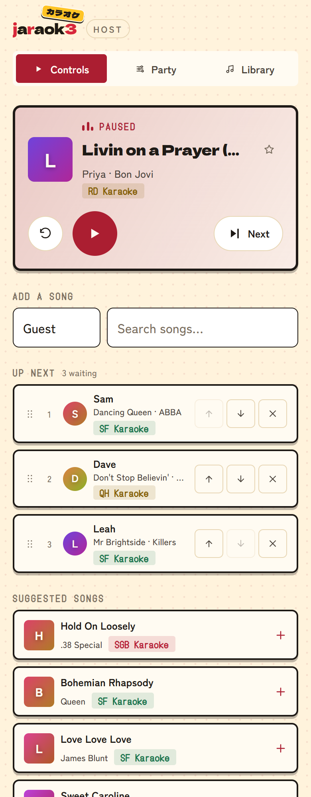

# jaraok3

Self-hosted karaoke for house parties. One server, three screens:

- **Guests** scan a QR code and pick songs from their phones. No app, no accounts, just a name.
- **The TV** plays CDG or video karaoke fullscreen, with the singer's name, up next, and a join QR.
- **The host** runs the night from a phone: play/pause/skip, reorder, star the good versions.

<p align="center">
	
	&nbsp;&nbsp;
	
</p>

## Features

- **Search that keeps up with big libraries.** A SQLite FTS5 trigram index serves as-you-type results
  over a 90,000-song collection, with fuzzy "did you mean" and duplicate collapsing: one row per song,
  expandable to every brand's version.
- **Version quality control.** Tag each karaoke brand green / yellow / red, set brand priority for
  duplicate songs, and star the definitive rendition so it wins search for everyone.
- **YouTube fallback.** Keyless YouTube search via yt-dlp for anything the library is missing.
  Embeddable picks play in an IFrame player; picks whose owner blocks embedding are downloaded
  on the spot (yt-dlp + ffmpeg, both in the Docker image), join the queue instantly as a pending
  item, and flip to playable local video when ready.
- **Suggestions.** "Suggested for you" and "Keep it going" panels blend Last.fm similar-artist data
  (optional API key) with the party's own play history. With no key and no internet it degrades
  gracefully to library-only picks.
- **Party-proof queueing.** Guests see the whole lineup, get a live "you're #4" position, and can
  remove their own picks. The TV flashes just-added songs. Hosts get drag *and* touch-arrow
  reordering, bump-to-top, restart, and requeue from history.
- **Themes.** Seven looks for the TV and each phone, picked separately.
- **Optional: live voice effects.** With mics into an audio interface on the server, PipeWire mixes
  them with the songs, and the host tunes gate, compressor, EQ, echo and reverb from the Sound tab,
  with presets. Guests can set their own echo and reverb for their songs.
- **Optional: kiosk mode.** systemd + cage service templates boot the server straight into the TV
  display, and a **System on/off** button on the host page starts and stops it remotely.
- **PIN-gated admin.** One PIN prompt, then a signed HMAC cookie. Guests never see the controls.

## Hardware

The minimum is a Linux box with Docker (amd64 or arm64; a Raspberry Pi 4/5 works) and a TV
with a browser, or any device at the TV that has one. Guests only need to reach the server
over Wi-Fi.

The full setup the optional parts are built for:

- **Mini PC (the server).** Runs the app, holds the library, drives the TV and mixes the mics.
  2+ cores, 4 GB RAM, HDMI out, and a GPU that hardware-decodes H.264 (any recent Intel/AMD
  integrated graphics).
- **Storage.** Enough disk for your song library plus downloads. An external USB drive is fine.
- **TV.** Any TV or projector with HDMI, plugged into the mini PC.
- **Mics and an audio interface.** Wired or wireless mics into a USB audio interface's input
  (one mic, or two on a stereo line in). The server mixes them with the music and adds the
  effects, so no separate mixer is needed.
- **Speakers.** Powered speakers (or an amp and speakers) on the interface's output.

```
phones ──Wi-Fi──▶ mini PC ──HDMI──▶ TV
                    ▲   │
               mics │   │ mixed audio
                    │   ▼
mics ──────▶ audio interface ──────▶ speakers
```

## Configuration

Everything that depends on your setup lives in `.env` (start from `.env.example`, which explains
each line). Nothing in the code needs changing for different hardware.

| Setting | Default | What it switches |
| --- | --- | --- |
| `MIXER` | `off` | The Sound tab and guests' "Your sound". Needs [`deploy/audio/`](deploy/audio/). |
| `MIC_INPUTS` | `2` | One or two mic inputs on the Sound tab. |
| `KIOSK` | `off` | The host page's System button. Needs [`deploy/kiosk/`](deploy/kiosk/). |
| `YOUTUBE` | `on` | YouTube search and the yt-dlp updater. |
| `DOWNLOADS` | `on` | On-demand downloads of videos that won't embed. |
| `LIBRARY_RECURSIVE` | `on` | Scanning subfolders; `off` for a huge library on a slow exFAT drive. |
| `PUBLIC_APP_NAME` | `jaraok3` | The name in titles and the wordmark. |
| `KARAOKE_PORT` | `3000` | The host port. |
| `JOIN_URL` | the TV's own address | The guest address on the TV's QR code. |

What's switched off doesn't show on any page, and the server refuses it too.

## Architecture

SvelteKit 5 (adapter-node) built and wrapped by a small `server.js` that adds Socket.io: party state
(current song, queue, history) lives in memory on the server, and every client role (`guest`,
`display`, `control`) receives live snapshots over `/ws`. The library index is better-sqlite3 with
FTS5; media is served with HTTP Range support. On the display, [cdgraphics](https://github.com/bhj/cdgraphics)
renders CDG lyric graphics to a canvas, MP4s use a plain `<video>`, and YouTube uses the IFrame API.

## Your library

jaraok3 scans a folder (and its subfolders) of files named `Artist - Title [BRAND].ext`:

| Files | What you get |
| --- | --- |
| `.mp3` + `.cdg` pair | Classic CDG karaoke with rendered lyrics |
| lone `.mp3` | Audio only; the display shows a title card |
| `.mp4` | Karaoke video (H.264 + AAC recommended) |

The `[BRAND]` suffix drives version tiering and priority; files without it still index fine.
The brand tiers start from a list of well-known karaoke labels, and the host can change any of
them. On-demand YouTube downloads land in a `downloads/` subfolder, named to the same scheme so
they merge with their CDG twins.

## Quick start (Docker)

```bash
git clone https://github.com/jrow3/jaraok3.git
cd jaraok3
cp .env.example .env
nano .env                        # set KARAOKE_LIBRARY and ADMIN_PIN
docker compose pull              # the published image, amd64 or arm64
docker compose up -d
docker compose logs -f karaoke   # first boot indexes the library once; after that it's instant
```

Then open:

| URL | Screen |
| --- | --- |
| `http://<server>:3000/` | Guest page: this is what the QR points at |
| `http://<server>:3000/display?t=<DISPLAY_TOKEN>` | Fullscreen TV display |
| `http://<server>:3000/admin` | Host controls (your PIN) |

[`DEPLOY.md`](DEPLOY.md) covers publishing it for guests on mobile data, updating, and YouTube
sign-in trouble.

Practical notes:

- If you publish the guest page through a reverse proxy or tunnel, keep the display on a LAN URL so
  media never leaves the house: only the display ever streams audio/video. Set `JOIN_URL` to the
  public address.
- The library is mounted read-only; only `downloads/` is writable.
- On-demand YouTube downloading exists because some channels block embedding. Make sure your use of
  it complies with YouTube's terms and your local law; `DOWNLOADS=off` turns it off.

## Development

```bash
npm install
cp .env.example .env    # set LIBRARY_PATH under "Local dev only"
npm run dev
```

`npm test` runs the Vitest suite, `npm run check` type-checks, and
`cd deploy/audio && python -m pytest` tests the mixer agent. The design system (tokens, type,
icons) lives in `src/app.css` and `src/lib/components/ui/`. The UI font is
[Bricolage Grotesque](https://github.com/ateliertriay/bricolage) (SIL OFL, self-hosted in
`static/fonts/` with the other theme fonts, each with its licence).

## License

MIT; see [`LICENSE`](LICENSE).
